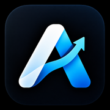
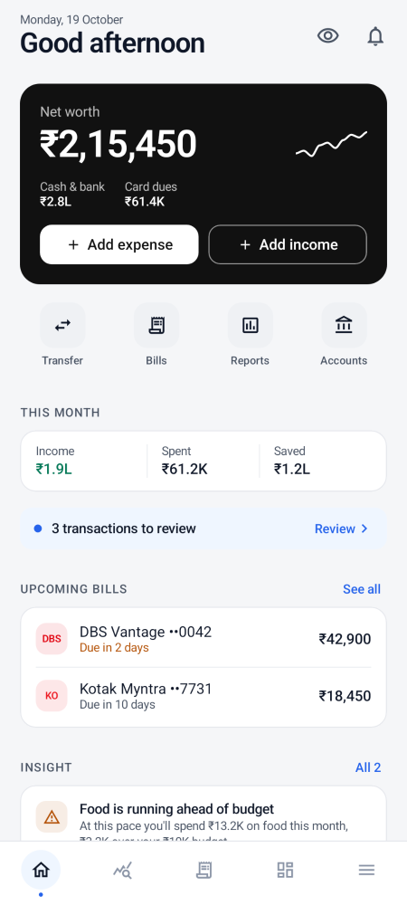
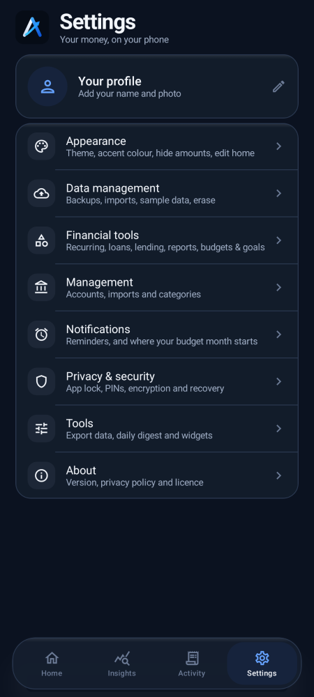
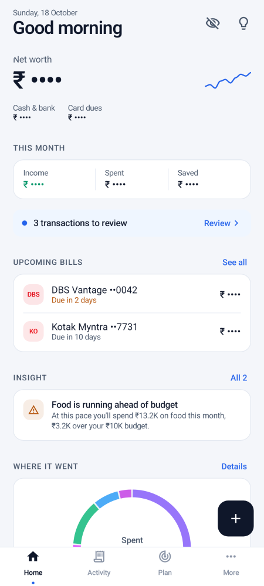
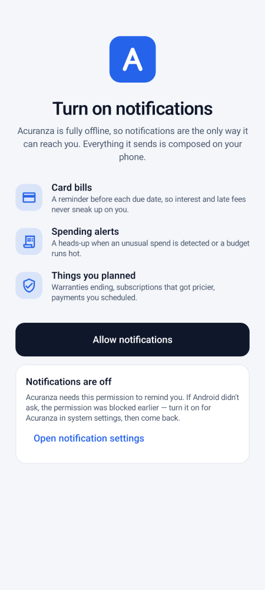
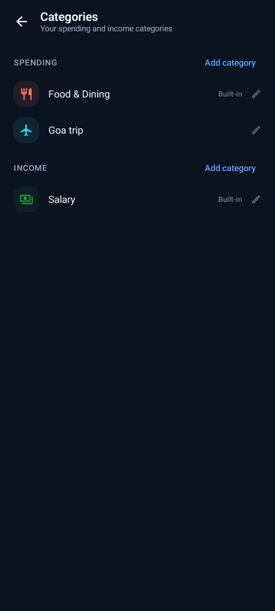
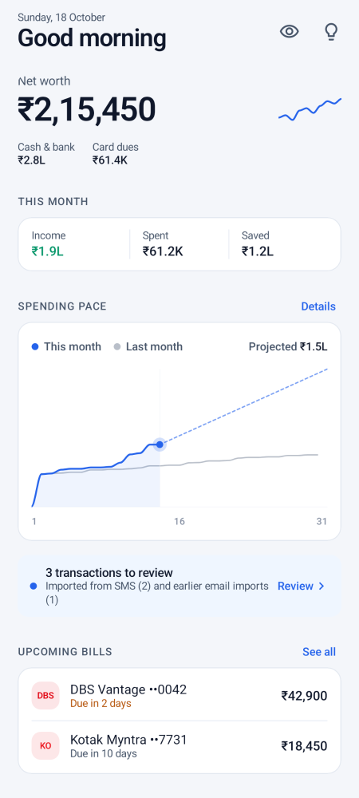
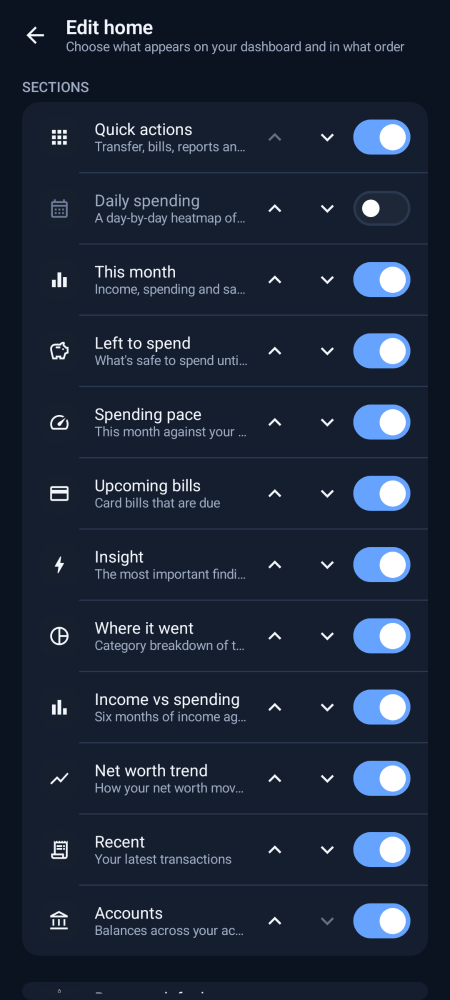

<h1 align="center">Acuranza</h1>

  

  <b>Free and open-source personal finance for Android.</b> 
  Local-only, encrypted, no network permission — your money data never leaves the phone.

  
  
  

---

<b>📋 Table of Contents</b>

- <a href="#about-acuranza">About Acuranza</a>
- <a href="#feature-highlights">Feature Highlights</a>
- <a href="#privacy--security">Privacy & Security</a>
- <a href="#screenshots">Screenshots</a>
- <a href="#install">Install</a>
- <a href="#build-from-source">Build from Source</a>
- <a href="#license--attribution">License & Attribution</a>

---

## About Acuranza

Acuranza is a personal-finance app built for privacy and offline use. Track income, expenses, credit cards, bills, budgets and goals entirely on your device. Add transactions by hand, import bank-statement CSVs, or share bank SMS messages — every insight is computed locally, never uploaded.

Designed to be **minimal, tactile and glanceable**: bold typography, clean hierarchy, restrained colours, and components sized for one-handed use.

---

<h2 align="center">Feature Highlights</h2>

  
  
  

  <em>Left to right: home dashboard, settings hub, settings in dark theme.</em>

| Category | What you get |
|----------|-------------|
| **Home dashboard** | Net worth card, this-month income/spent/saved, upcoming bills, quick-add actions, and a “safe to spend” pill that respects your salary cycle. |
| **Accounts & cards** | Balances that reconcile with your bank, card outstanding and utilisation, “mark paid” recording. |
| **Budgets & goals** | Monthly budgets that follow your salary cycle with pace projection and rollover; savings goals with progress rings, EMI/loan calculator and Monte Carlo success probability. |
| **Transactions** | Add by hand or import bank-statement CSV (HDFC, ICICI, SBI, Axis, Kotak and others); review inbox with confirm-all; tags, splits, IOUs, receipts (photo/PDF, encrypted). |
| **Recurring & bills** | Subscriptions, EMIs, UPI AutoPay / NACH mandates found in your spending; due-date reminders with price-change alerts. |
| **Reports & insights** | Monthly & yearly PDF reports, Beancount & Ledger export, year-in-review, daily spending calendar, offline rules for budget pace, spending spikes, savings rate and unusual spends. |
| **Everyday tools** | Home-screen widgets (this month, savings goal, spending by category, quick add), a Quick Settings tile, haptic feedback with Light/Standard/Strong strengths, and a default-landing-tab choice. |

---

<h2 align="center">Privacy & Security — By Design</h2>

  
  

| Principle | Implementation |
|-----------|---------------|
| **No network, ever** | The APK requests no INTERNET permission — not even in dependencies. Nothing can leave the phone. |
| **Encrypted at rest** | SQLCipher database (AES-256); key held in the Android Keystore. Backups use AES-256-GCM with PBKDF2 (600k iterations) under a password only you know. |
| **SMS is opt-in** | Standard build is permissionless: you share or paste bank messages. Full build reads SMS/notifications only after explicit consent, both revocable, message bodies parsed in memory and never stored. |
| **App lock** | Biometric lock or PIN with a decoy-PIN mode that opens an empty profile; privacy mode masks amounts everywhere, including screen-reader labels. |
| **Local-only** | `allowBackup="false"`; database, preferences and datastore excluded from cloud backup and device transfer. |

> Acuranza asks for **one** permission before first launch: notifications (reminders for bills, scheduled payments and unusual spending). Everything else is opt-in and clearly explained.

---

<h2 align="center">Screenshots</h2>

  
  
  
  

  
  
  
  

  
  
  
  

---

<h2 align="center">Install</h2>

  
  

**Two builds, same app:**

| Build | SMS permission | Best for |
|-------|---------------|----------|
| **Standard** | Not requested | Share or paste bank messages; sideloads cleanly, Play Protect friendly. |
| **Full** | Requested (opt-in) | Automatic inbox scan and notification capture; may trigger Play Protect warnings on sideload. |

Both variants share identical code, features and signing key — upgrades install cleanly over previous versions.

See [BUILDING.md](docs/BUILDING.md) for source-build instructions and [PRIVACY.md](docs/PRIVACY.md) for the full privacy policy.

---

<h2 align="center">License & Attribution</h2>

Acuranza is free software under the [GNU General Public License v3.0 or later](LICENSE). It derives from the upstream **Kosh** project; each file keeps its original copyright notice, and the git history records every change.

  Built with Kotlin + Jetpack Compose · SQLCipher · Material 3 · Offline first

