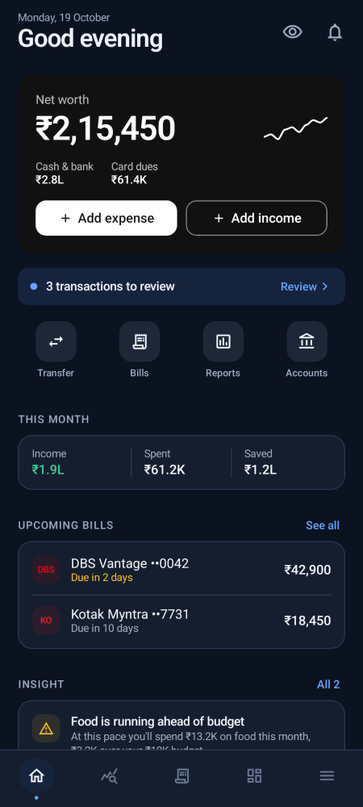
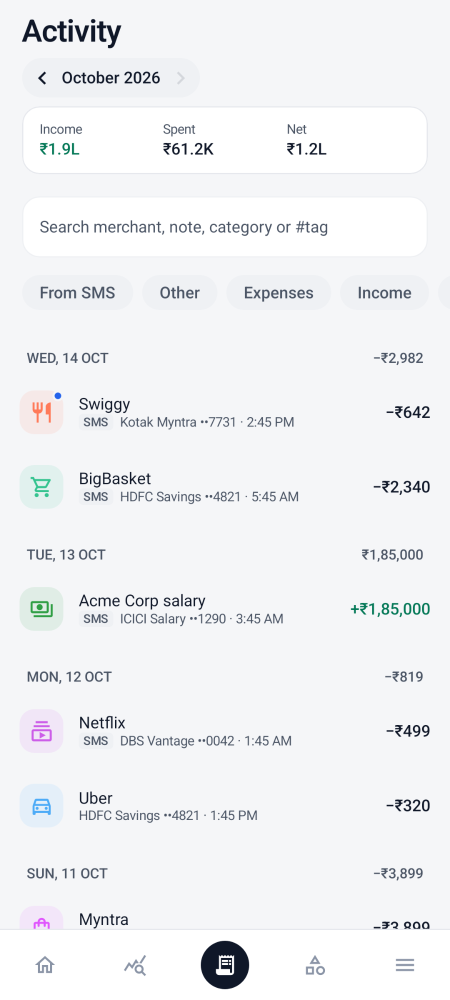
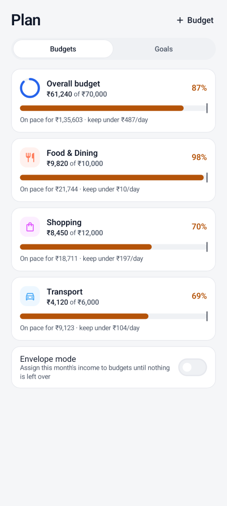
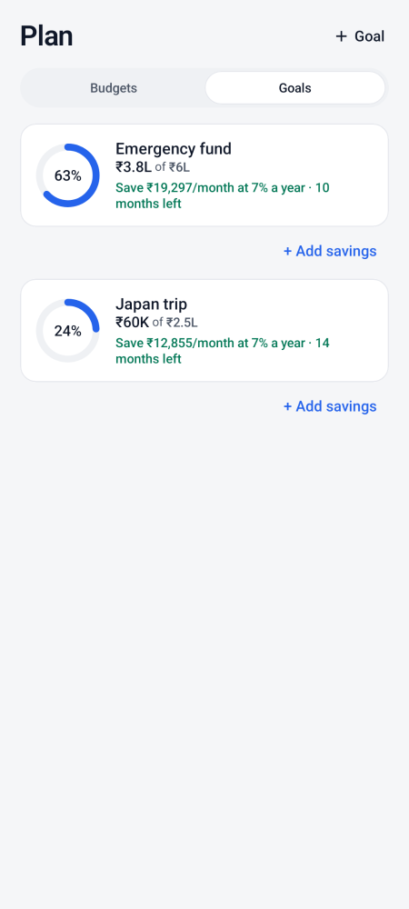
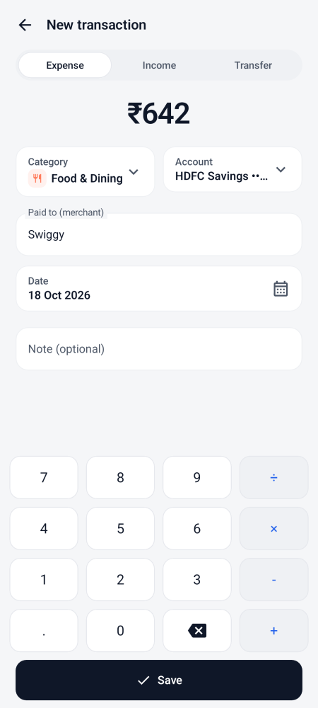
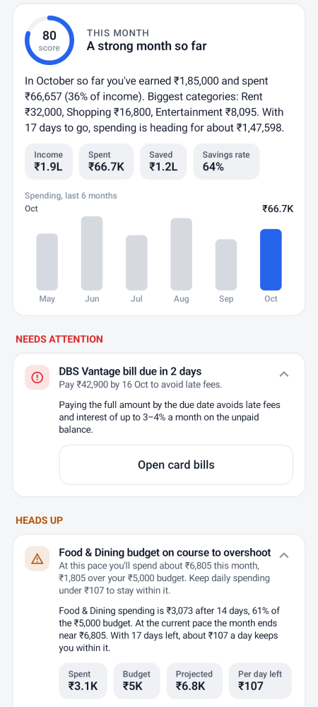

<h1 align="center">Acuranza</h1>
<p align="center"><b>A private, fully offline personal finance tracker for Android, built for Indian banking.</b></p>

<p align="center">
  <a href="LICENSE"></a>
  
  
  
  
</p>

**Free and open source.** No ads, no account, no servers, no analytics — and no INTERNET permission at
all, so Android itself guarantees that your money data never leaves the phone.

Acuranza tracks income, expenses, credit cards, bills, budgets and goals. You add transactions by
hand or import bank-statement CSVs, and every insight is computed on the phone.

> Acuranza is a derivative of **[Kosh](https://github.com/AIM-IT4/kosh)** by Amit Kumar Jha and
> contributors, used under the terms of the GNU General Public License v3.0 or later. The complete
> upstream history is preserved in this repository's git log; Acuranza keeps Kosh's license and adds
> its own interface, a stricter offline build, a notification gate on first launch, and a narrower,
> spending-focused feature set (the Tax planner and the FD/EPF/NPS wealth sections were removed).

## Screens

Dark mode is the default on first launch. These are rendered from the app's own Compose UI with
sample data (the Paparazzi tests in `app/src/test` regenerate them on every run).

<p align="center">
  &nbsp;
  &nbsp;
  &nbsp;
  
</p>
<p align="center">
  &nbsp;
  &nbsp;
  &nbsp;
  
</p>


## What it does

- **Bank statement import (CSV)**: statements from net banking (HDFC, ICICI, SBI, Axis, Kotak and
  others), de-duplicated and sorted into categories — no message reading of any kind.
- **Review inbox**: confirm or fix imported transactions; recategorising a merchant remembers that
  category for future imports.
- **Accounts and cards**: balances that reconcile with what you know, card outstanding and
  utilisation, and "mark paid" recording the transfer from your bank account.
- **Card bills**: due dates, amounts and payment status, with due-date reminders.
- **Budgets**: monthly budgets that follow your salary cycle, pace projection, optional rollover of
  unspent money, and an envelope (zero-based) mode.
- **Goals**: with the monthly saving they need, an optional purchase loan (EMI and total interest),
  and a success probability from a Monte Carlo simulation.
- **Safe to spend**: what you can spend each day until payday, after card bills and repeating
  payments due before it.
- **Recurring & subscriptions**: repeating payments found in your spending (subscriptions, EMIs,
  UPI AutoPay / NACH mandates), what's due in the next 30 days, price-change alerts, and scheduled
  entries (rent, SIPs) that add themselves on their dates.
- **Loans & EMIs**: amortisation schedule, what's still owed (counted in net worth), and a
  prepayment calculator (fewer EMIs or a lower EMI).
- **Tags, splits and IOUs**: tag transactions (`#goa-trip`), split one payment across categories,
  and track money lent to or borrowed from people.
- **Receipts and warranties**: attach a bill photo or PDF to a transaction, encrypted on the phone,
  with a reminder before a warranty ends.
- **Reports**: monthly and yearly PDF reports, a year-in-review, and a calendar of daily spending
  and upcoming payments.
- **Bank statement import**: CSV statements from net banking (HDFC, ICICI, SBI, Axis, Kotak and
  others), de-duplicated so re-imports add nothing new.
- **Insights**: offline rules including budget pace, spending spikes, savings rate, subscriptions,
  card utilisation, emergency-fund cover and unusual spends.
- **Export**: CSV (opens in Excel), Beancount and Ledger, so your data is never locked in.
- **Everyday tools**: home-screen widgets (this month, quick add), a quick-add tile in Quick
  Settings, and an optional daily digest notification.
- **Languages**: English and Hindi (हिन्दी).

## Privacy and security

- **No network, by construction.** The APK does not request the INTERNET permission (or any other
  network permission), so no code in it — ours or a dependency's — can open a socket.
- **No message access.** Acuranza holds no SMS permission — it reads no SMS, ever. History comes
  from bank-statement CSV files you pick yourself, or from manual entry.
- **Encrypted database:** SQLCipher (AES-256), with the key kept in the Android Keystore.
- **Biometric lock, app PIN with a decoy PIN** (opens an empty profile), privacy mode and
  screenshot blocking.
- **Encrypted backups:** AES-256-GCM with a password-derived key (PBKDF2, 600k iterations), to a
  folder you pick, on a schedule you choose.
- **Local-only data:** everything stays on the device and is excluded from cloud backups
  (`allowBackup="false"`).

Acuranza asks for exactly one permission before the app opens on first launch:
**notifications**. They are how reminders reach you — card-bill due dates, unusual spending,
warranties ending and payments you scheduled — and the app is gated until they are allowed
(with a clear path through system settings; it never crashes or loops when denied).
It asks for nothing else — no SMS, no contacts, no location, no network.

## Architecture

| Module | Contents |
| :-- | :-- |
| `core:model` | Money (paise, Indian formatting), shared types |
| `core:sms` | Statement/CSV parsers, merchant normalisation, category guessing |
| `core:finance` | Budgets, goals and Monte-Carlo outlook, insight engine, loans, recurring payments |
| `core:designsystem` | Compose theme, charts, components, logo |
| `app` | Room database, repositories, statement import, WorkManager jobs, UI screens |

Kotlin, Jetpack Compose with Material 3, Room with SQLCipher, WorkManager and DataStore.
No Google Play Services, no analytics, no crash-reporting SDKs.
The engine modules are plain Kotlin with unit tests.

## Building

```bash
./gradlew test                    # unit tests for every module
./gradlew :app:assembleDebug      # debug APK
./gradlew :app:assembleRelease    # release APK (signed when the keystore is present)
```

See [docs/BUILDING.md](docs/BUILDING.md) for the signing setup, the release checklist and the
security checks that run against every release APK.

## Contributing

Contributions are welcome, especially **bank statement formats** and **merchant categories**. The merchant rules
live in an open dataset, [`core/sms/src/main/resources/acuranza/merchants.json`](core/sms/src/main/resources/acuranza/merchants.json)
(format in [docs/DATASET.md](docs/DATASET.md)). See [CONTRIBUTING.md](CONTRIBUTING.md), and always mask
account numbers before sharing a statement. Security issues: see [SECURITY.md](SECURITY.md).

## License

Acuranza is free software under the [GNU General Public License v3.0 or later](LICENSE), as is the
Kosh project it derives from. Each file keeps the upstream copyright notice it carried; the git
history records every change made here.
